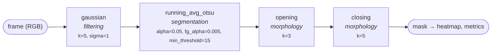
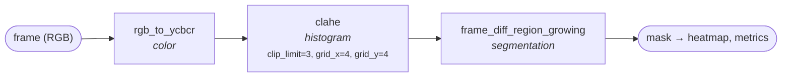
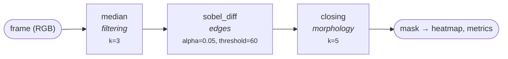
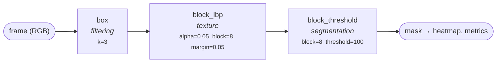
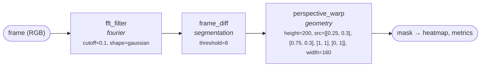
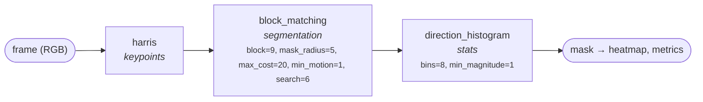
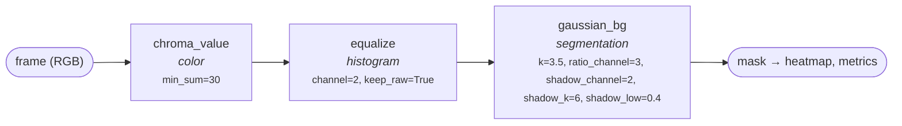
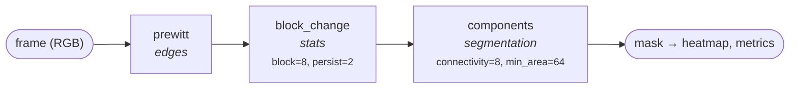

# Pipelines

Each of the 4 team members implements 2 pipelines from the pool below. Every pipeline has at least 3 stages from at least 3 distinct categories, and no two members share a pipeline.

## Pool

| ID | Stages (category) | What it tests |
|---|---|---|
| p1 | Gaussian filter (filtering) → running-average background model + Otsu threshold (segmentation) → opening/closing (morphology) | baseline |
| p2 | RGB→YCbCr (color) → CLAHE (histogram) → frame differencing + region growing (segmentation) | night and dark scenes |
| p3 | Median filter (filtering) → Sobel gradient difference (edges) → closing (morphology) | illumination changes |
| p4 | Box filter via integral image (filtering) → block-wise LBP (texture) → block threshold segmentation (segmentation) | shadows |
| p5 | FFT frequency filtering (fourier) → frame differencing with threshold (segmentation) → perspective warp to a floor plan (geometry) | top-down heatmap |
| p6 | Harris corners (keypoints) → block matching between frames (tracking/segmentation) → motion direction histogram (stats) | motion directions |
| p7 | RGB→HSV + chromaticity normalization (color) → histogram equalization (histogram) → per-pixel Gaussian background model (segmentation) | shadows and lighting changes |
| p8 | Prewitt gradient magnitude (edges) → block statistics: mean and variance change (stats) → connected components with area filter (segmentation) | small noise, bad weather |

p7 and p8 were added on top of the original pool of six so that 4 members × 2 pipelines = 8 distinct pipelines. Check all methods against labs 5–6 before finalizing.

## Owners

| Pipelines | Owner |
|---|---|
| p1, p2 | Illia |
| p3, p4 | Yaroslav |
| p5, p6 | Vladyslav |
| p7, p8 | Volodya |

## Configurations

Each pipeline is a YAML file in `configs/pipelines/`. `heatmap run` and the web UI build it from the method registry (see [methods.md](methods.md)) and refuse to run it unless it has at least 3 stages from at least 3 distinct categories. The diagrams below show the shipped parameters.

### p1 — Baseline background subtraction

Owner: Illia. Gaussian blur, running-average background with an Otsu threshold, then opening and closing.

### p2 — Night and dark scenes

Owner: Illia. Luma from YCbCr, CLAHE to lift dark regions, frame differencing grown into regions.

### p3 — Illumination-robust edges

Owner: Yaroslav. Median filter, change of Sobel gradients against a background, closing.

### p4 — Shadow-robust texture

Owner: Yaroslav. Box filter, block-wise LBP texture change, block threshold.

### p5 — Top-down heatmap

Owner: Vladyslav. FFT low-pass, frame differencing, perspective warp of the mask onto a floor plan.

### p6 — Motion directions

Owner: Vladyslav. Harris corners, block matching between frames, motion direction histogram.

### p7 — Shadows and lighting changes

Owner: Volodya. Chromaticity + HSV value, equalized value, per-pixel Gaussian background with shadow suppression.

### p8 — Small noise and bad weather

Owner: Volodya. Prewitt gradients, block mean/variance change detector, connected components with an area filter.

## Results on the built-in synthetic scenes

F1 on clean frames (`heatmap experiment -config configs/experiments/main.yaml`; frames with ground truth only). The scenes are generated by `internal/dataset/synthetic.go` with exact ground truth: `street` (car and pedestrian on textured asphalt), `shadow` (an object with a hard shadow labelled 50, i.e. background) and `night` (two dim objects in a dark, low-contrast scene).

| Pipeline | street | shadow | night | What it shows |
|---|---|---|---|---|
| p1 | 0.937 | 0.657 | 0.994 | strong baseline, but takes the shadow for motion (precision 0.49 on `shadow`) |
| p2 | 0.416 | 0.473 | 0.472 | frame differencing sees object edges, not their interiors |
| p3 | 0.684 | 0.504 | 0.496 | gradient change; high recall, blobby masks after closing |
| p4 | 0.783 | 0.626 | 0.334 | texture (LBP) ignores the shadow better than intensity, weak on flat dark scenes |
| p5 | 0.508 | 0.379 | 0.148 | frame differencing after an FFT low-pass; its point is the top-down heatmap |
| p6 | 0.721 | 0.493 | 0.205 | sparse corner motion; dominant direction 0° (the car drives right) |
| p7 | 0.961 | **0.960** | 0.444 | the only pipeline that suppresses the shadow (precision 0.94) |
| p8 | 0.615 | 0.444 | 0.641 | block statistics: near-perfect recall, coarse 8×8 masks |

With noise the filtering stages matter. Under `salt_pepper:0.02` on `street`, p3 (median filter) keeps F1 0.676 and p8 (area filter) even rises to 0.730, while p2, p5 and p6 fall below 0.2; on `night` p8 collapses too (0.129) and on `shadow` p3 drops to 0.197. Under `gaussian:10`, p1, p5, p6 and p8 barely change, p7 loses a little on `street` (0.961 → 0.915) but fails on `night` (0.003), and p2 fails almost completely (≈ 0.05). `configs/testcases.yaml` turns the key observations into checked thresholds (`heatmap testcases`, run in CI).

